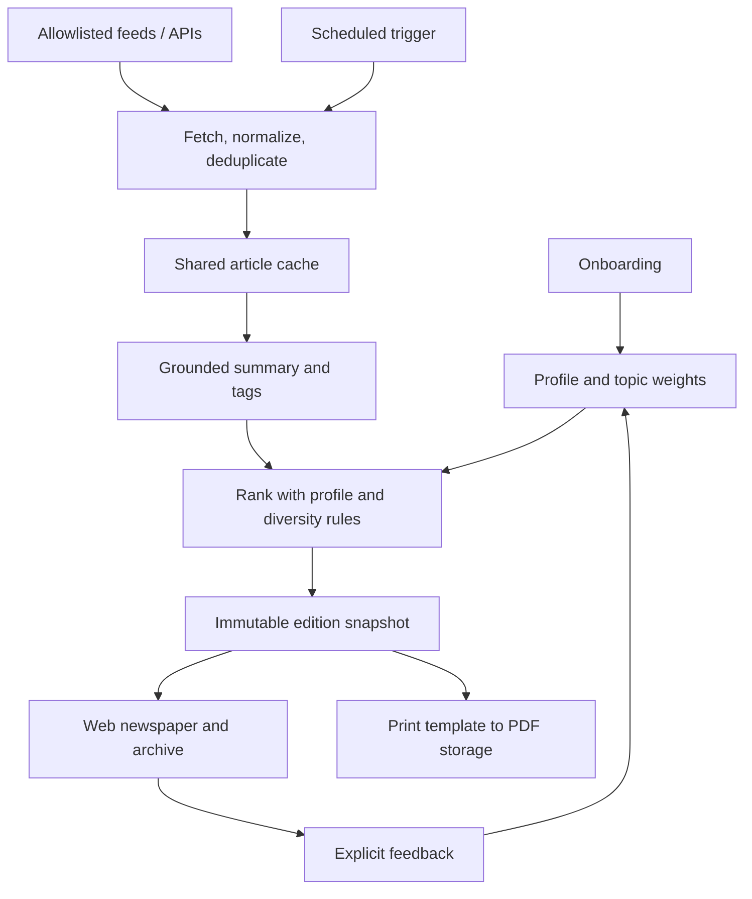

# Personal Morning Paper: nine-hour build plan

Planning baseline: 17 October 2026. User has nine hours remaining and works in Next.js, TypeScript, and Tailwind. Team size, deployed hosting account, API keys, and exact spending cap are unknown. Assume one implementer using Claude Code. This is a planning document, not implemented functionality.

## Product decision

Working name: Dayline. Promise: "Your interests. One morning paper. Five minutes well spent."

Build a finite, readable daily edition with 6-8 stories. Make the strongest demonstration two readers receiving different front pages from the same source pool, then a feedback action changing the selection for a future edition. The newspaper PDF is a core feature from the beginning.

Proposed flagship enhancement: "Since your last read" shows supported developments in stories the reader explicitly marked as read. Keep "Why this story?" as a simple explanation tied to actual matching interests. Read QUALITY_AND_DIFFERENTIATION.md for the bounded implementation and engineering standards. This is a recommendation, not an implemented feature. Drop the optional recap to protect the time budget.

Do not schedule chat, audio, Urdu translation, social features, arbitrary website crawling, vector databases, trained recommenders, or an autonomous agent framework within this nine-hour build.

## Requirements extracted from the supplied brief

Source: C:/Users/muham/OneDrive/Desktop/NaSCon'26 Problem Statement.pdf, both pages reviewed.

| Requirement | Implementation | Evidence at submission |
|---|---|---|
| Capture interests with good onboarding | Three short steps: topics, optional free text, reading budget | Complete onboarding live |
| Fresh personalized daily PDF with newspaper layout | Saved edition rendered with masthead, columns, date, sections and source links | Download and open actual PDF |
| Complete web reading experience | Lead story plus concise standalone summaries and original links | Read an edition without leaving the app |
| Same edition in web and PDF | Both consume the same saved edition snapshot | Compare titles, ordering and text |
| Previous papers accessible | Archive backed by persisted editions | Reopen a prior saved edition |
| Learn from reader behavior | Explicit more/less feedback changes topic weights used by the next generation | Show preference change and resulting ranking change |
| Skip unwanted stories | Hide on screen; optionally indicate "already read" | Interaction works without silently rewriting the archived edition |

The brief requires a repository created at the start of the hackathon with monitored commits, a public GitHub link at submission, a product Loom video of at most five minutes, and an architecture diagram. It provides no judging weights, exact deadline, mandatory AI model, or required agent framework. Treat any proposed judging priorities here as strategy, not an official rubric. Verify any additional organizer messages separately.

The user additionally reports that readability, scalability and maintainability will be judged. Treat these as explicit project acceptance criteria; their official weighting remains unknown.

## Nine-hour execution budget

Times are relative to implementation start. Reduce optional work if planning/setup consumes part of the remaining deadline.

| Elapsed time | Deliverable | Exit condition |
|---|---|---|
| 0:00-0:30 | Repository, environment and feasibility checks | Deployed hello page; one hosted PDF download; at least two live source responses; DB write/read; one model response |
| 0:30-1:30 | Persisted vertical slice | Sample edition saved, readable on web, downloadable as PDF, visible in archive after reload |
| 1:30-2:30 | Live ingestion and grounded summaries | Real dated articles from 3+ distinct publishers/providers; valid original links; summaries use retrieved text only |
| 2:30-3:30 | Onboarding and newspaper design | Two profiles produce visibly different saved editions; mobile web and 2-page PDF are readable |
| 3:30-4:00 | Learning loop | More/less changes stored weights and next selection; neutral skip does not act as a strong dislike |
| 4:00-5:00 | Proposed continuity feature, only if core is on track | Explicit read state and one evidence-linked story update; ambiguous matches fall back to an ordinary story |
| 5:00-6:00 | Daily generation and deployment integration | Scheduled trigger tested; duplicate jobs do not duplicate daily editions; archive and PDF work on deployed host |
| 6:00-7:00 | Reliability and acceptance checks | Core journey passes; source/API failures handled; long headlines and PDF overflow fixed |
| 7:00-8:00 | Submission package | Architecture diagram, README, demo accounts/data and <=5-minute Loom ready |
| 8:00-9:00 | Buffer and submission | Rehearse, fix only critical defects, verify public repo and submit before cutoff |

Checkpoint: by hour two there must already be an end-to-end saved edition and PDF. If not, stop design embellishments until it works. Freeze new features by hour six. Never cut required PDF, archive, or learning to make room for a bonus feature.

## Technical approach

Use Next.js App Router, TypeScript and Tailwind in one repository. Supabase supplies Postgres, authentication and private PDF storage. Prefer anonymous authenticated sessions for the shortest demo onboarding, if available in the project; users keep their browser session but cross-device recovery is out of scope. Apply user ownership checks and row-level security to profiles, feedback, editions and stored PDFs. The browser never receives the service-role or model API secret. Next.js supports this TypeScript/Tailwind setup in its standard installation workflow ([official setup](https://nextjs.org/docs/app/getting-started/installation)); Supabase documents [row-level security](https://supabase.com/docs/guides/database/postgres/row-level-security).

Use one existing accessible hosted LLM through its official SDK. Select the exact model after checking available keys and one response in the first 30 minutes. Model choice must not block the rest of the app. Track tokens/requests, cache article summaries, and set a per-run request cap; choose an actual spending cap with the user before bulk calls. Start with one provider rather than building multiple integrations.

Use server-side Playwright/Chromium to render a dedicated print route into a PDF. Its API supports print CSS ([documentation](https://playwright.dev/docs/api/class-page#page-pdf)). Test Chromium on the intended host immediately. If that runtime cannot support it within 20 minutes, use a hosted browser endpoint or a server PDF library with explicit newspaper columns. Browser print can assist development, but the submitted feature should download a real PDF.

Use Supabase Cron to invoke an authenticated generation endpoint or enqueue due work. Cron supports HTTP calls and job monitoring ([documentation](https://supabase.com/docs/guides/cron)). Keep job batches within measured hosting limits. For this demo, cap supported users and process small batches; do not introduce a queue service unless runtime limits force it.

## Sources and AI boundaries

Choose 3-5 reliable sources spanning the topics offered in onboarding. Hide unsupported topics rather than promising personalization for an empty category. Start with an allowlisted RSS/API adapter; fetch once for the shared pool instead of scraping separately for every reader. Source coverage is an early implementation check, not something already verified by this planning pass.

NASA provides an official [RSS directory](https://www.nasa.gov/rss-feeds/), and JPL provides its own [feed directory](https://www.jpl.nasa.gov/rss/). These are useful discovery starting points for science coverage; they do not establish broad topic coverage. Check each chosen source's permitted reuse, attribution and AI processing before enabling it. RSS availability alone does not grant unrestricted republication rights.

NewsAPI's free Developer tier is restricted to development/testing and is unsuitable as the default for a deployed submission ([pricing](https://newsapi.org/pricing)). Guardian's developer offering mentions hackathons, but its terms restrict AI-related use; exclude it from AI processing without permission ([terms](https://www.theguardian.com/open-platform/terms-and-conditions)).

Store source name, canonical URL, published time, fetched time, input text and input coverage (full text or excerpt). If only an excerpt is available, present an excerpt-based brief; never imply the model read the full article. Do not expand a headline into invented details. If no adequate text exists, show a linked headline with a clear limited-coverage label.

Deduplicate canonical URLs first, then normalize titles to catch obvious repeats. Topic tags can start from feed categories plus a small fixed taxonomy; the model can refine tags in the same summary call. Avoid embeddings for this scope.

Prompt the model to output validated structured data: article ID, headline, 60-100-word brief, 2-3 supported takeaways, topic tags, and supporting source excerpts. Validate IDs, field lengths and source references in code. Supporting excerpts help audit the result but do not prove factual accuracy. Manually inspect the actual demo stories. Retry once on malformed output; otherwise use the source excerpt with a clear label.

Treat article text as untrusted content, never as instructions. Give the summary step no tools. Parse/sanitize feed HTML; only allow http(s) source links; cap fetch sizes, timeouts and concurrency. These controls directly prevent bad content from breaking the demo or steering the pipeline.

## Personalization that can be demonstrated

Onboarding: choose up to three supported topics, optionally specify entities/interests in one sentence, choose 3/5/10 minutes. The five-minute default yields approximately 6-8 concise stories, with the final word budget calculated from actual content length. Optional text maps into known topics and visibly editable preferences.

Start with a deterministic score: 60% topic match, 20% freshness, 10% explicit entity match and 10% novelty. These are tuning defaults, not a validated recommender. Normalize each component; exclude blocked topics first. Apply a maximum of two stories per publisher and reserve one slot for a related discovery if coverage allows. Relax soft diversity constraints transparently when the pool is small.

Feedback: "More like this" increases relevant topic weights; "Less like this" decreases them. Clamp and normalize weights, deduplicate event submissions, and cap cumulative changes so one click cannot dominate the profile. A skip is neutral initially. Add save as a weak positive only if the explicit feedback loop already works. Do not treat a long-open browser tab as proof of interest.

Show "Why this story?" from actual ranking inputs, e.g. "Matches your Space interest; published today." Do not ask an LLM to invent an explanation after ranking.

For the demo, use a clearly labeled "Preview next edition" action with the current article pool. It demonstrates changed ranking without claiming tomorrow's news exists. Keep the original daily edition intact and exclude previews from normal daily archives. A preview is not evidence of automatic daily generation; demonstrate the scheduled job separately.

## Data contract and daily semantics

Core tables: profiles, articles, feedback_events, editions. Store the small edition's ordered story snapshots as validated JSON rather than overengineering relational tables. Add a generation_jobs table only for observable status/retry management if needed.

Each edition stores ID, owner ID, local edition date, timezone, generated timestamp, source fetch timestamp, profile snapshot/version, ordered stories, PDF status/path and edition type (daily or preview). Snapshot summaries and titles: later ingestion or feedback must not rewrite an old issue.

Enforce one daily edition per user/local date with a database constraint and idempotent job handling. Use Asia/Karachi for the initial product and display it clearly. Return the existing edition on repeat requests. Do not silently regenerate today's paper after feedback; apply learning to previews and future dates.

Daily flow: collect fresh stories, generate due users' editions, publish complete snapshots, render PDFs and expose status. Handle a partial PDF failure with a retry while keeping web content available. Use a tested scheduler plus generation-on-open catch-up for missed runs. Test day rollover with an injected clock or separate fixtures; never label fake backdated data as a real historical edition.

## Visual direction

Warm off-white paper, dark ink, one restrained accent, serif headlines, simple sans-serif controls, thin rules and generous spacing. The desktop edition has a masthead, date/issue number, one strong lead and a clear hierarchy of shorter stories. Mobile becomes a readable single column. Avoid animated loading theatrics and dense dashboard panels.

Create a dedicated two-page A4 template with controlled story lengths and explicit page boundaries. Include source links and edition ID. Test long titles, missing images, font loading, page breaks, text clipping and links. Both renderers consume the same snapshot; the layouts may differ but story content/order must match. Use typography instead of spending time on image search or generation.

## Claude Code working arrangement

Use one main implementation session as integrator. Add narrowly scoped helpers only after shared data contracts are stable: UI/PDF specialist, data/personalization specialist, and a read-only reviewer. For a solo nine-hour build, sequential implementation plus independent review is the default; use parallel writers only with disjoint files or isolated worktrees. No two agents should own schema migrations or shared types concurrently.

Claude Code supports project agents in `.claude/agents/` ([official documentation](https://code.claude.com/docs/en/sub-agents)). These are development assistants. The product itself uses deterministic orchestration with bounded LLM steps. Anthropic recommends starting with simple composable workflows and adding autonomy when needed ([engineering guidance](https://www.anthropic.com/engineering/building-effective-agents)).

Give Claude a compact CLAUDE.md containing stack, source boundaries, snapshot invariants, scope cuts and verification commands. Give it one milestone at a time with a concrete pass condition. Require build output, screenshots or a real PDF as evidence; this follows its [verification guidance](https://code.claude.com/docs/en/best-practices). Keep PROGRESS.md with completed work, known failures and the exact next action. Commit coherent milestones throughout the event.

## Submission checks and demonstration

Acceptance gates: persistent onboarding; 3+ distinct sources; two profiles with different top stories; supported summary claims; feedback changes next selection; web/PDF equality; archive survives reload; scheduled trigger works; duplicate invocation produces one daily edition; one user cannot fetch another user's paper; source/model timeout has an honest fallback; deployed PDF opens correctly.

Use a small meaningful test set for ranking changes, snapshot immutability and date/job idempotency, plus one browser journey from onboarding to PDF/archive. Do not spend the deadline constructing a large test suite. Capture measured latency and generation cost when available; do not invent metrics.

Five-minute Loom outline:

- 0:00-0:25: show the problem and the product promise.
- 0:25-1:00: onboard a reader.
- 1:00-1:50: read the paper and inspect sources/relevance reasons.
- 1:50-2:30: show a second profile's different front page.
- 2:30-3:15: give feedback and show a labeled next-edition preview.
- 3:15-4:00: download/open PDF and revisit an archived issue.
- 4:00-4:35: show architecture and actual scheduling mechanism.
- 4:35-4:55: state what works and known limits; finish under five minutes.

Use pre-generated real editions to keep the presentation responsive, and label cached/demo data honestly. Keep a local demo recording as backup. Confirm repository visibility, README setup steps, environment variable names without values, architecture diagram and Loom access before submitting. The brief's form is https://forms.gle/4i4Gf8vNv3Vu8ZLJ7; this plan has not opened or submitted it.

## Positioning from research

Existing products already aggregate sources and offer AI summaries or scheduled reports: see [Inoreader Intelligence](https://www.inoreader.com/features/intelligence) and [Feedly AI feeds](https://docs.feedly.com/article/807-how-to-create-ai-feeds). Do not claim the category is unprecedented. Our proposed emphasis is a finite morning ritual, polished matching PDF, transparent relevance and a visible learning loop. This is a pitch strategy, not a guarantee of winning.
