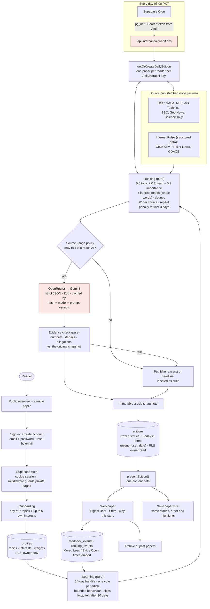

# Dayline architecture

One Next.js 15 application on Vercel and one Supabase project (Postgres, Auth, Cron, Vault). Pure rules live in `src/domain`; external systems are reached only through adapters in `src/server`; pages and server actions in `src/app` stay thin.

## How a paper gets better

1. **Explicit choices:** topics and up to five specific interests (for example "AI agents"), matched on whole words against each story's text.
2. **Feedback:** More / Less (strong), Skip (bounded, reversible) and opening the original (weak). Each article counts once, even if it appeared in several papers.
3. **Recency:** a signal loses half its effect every 14 days, so the paper follows what the reader cares about now. Weights are clamped after every signal, so a topic pushed to the floor can recover.
4. **Variety:** stories delivered in the last three days are pushed down when fresh alternatives exist.
5. **Transparency:** every story says why it was chosen; the edition saves the weights it used; past papers never change.

## Secrets (all server-only)

| Secret | Used by | Never |
|---|---|---|
| `SUPABASE_SECRET_KEY` | shared tables (articles, summaries), inserting a verified reader's edition, the daily job | in the browser; for reader reads |
| `SUPABASE_DB_URL` | `npm run db:migrate` (local tooling) | in the deployed app |
| `OPENROUTER_API_KEY` | `src/server/ai/openrouter-client.ts` | logged or returned |
| `CRON_SECRET` | daily endpoint (Vercel) and Supabase Vault | committed, logged or returned |

Public by design: `NEXT_PUBLIC_SUPABASE_URL` and `NEXT_PUBLIC_SUPABASE_PUBLISHABLE_KEY`; data is protected by row-level security.

## Data model

| Table | Purpose | Protection |
|---|---|---|
| `profiles` | topics (1 to 7), interests (≤5), cached weights | RLS owner |
| `feedback_events` | one current More/Less per reader, edition and story | RLS owner; must reference the reader's own edition |
| `reading_events` | Open and Skip, with Undo | RLS owner |
| `articles` | immutable article snapshots keyed by content hash | server-only |
| `article_summaries` | cached, evidence-checked summaries | server-only |
| `editions` | one per reader per local date; frozen stories, Today in three, profile snapshot | RLS owner read; unique (user_id, local_date) |

## Request paths

- **Reader:** cookie session → `auth.getUser()` → RLS-scoped reads → generation (shared writes through the secret client) → re-read through the reader's client.
- **Scheduled:** Supabase Cron → token from Vault → endpoint → the job loads reader ids itself → the same generation with one shared pool → counts-only response. A second run creates nothing.
- **Failure isolation:** each source is fetched independently; an AI or evidence failure falls back to the publisher's excerpt; one reader's failure doesn't stop the others.
