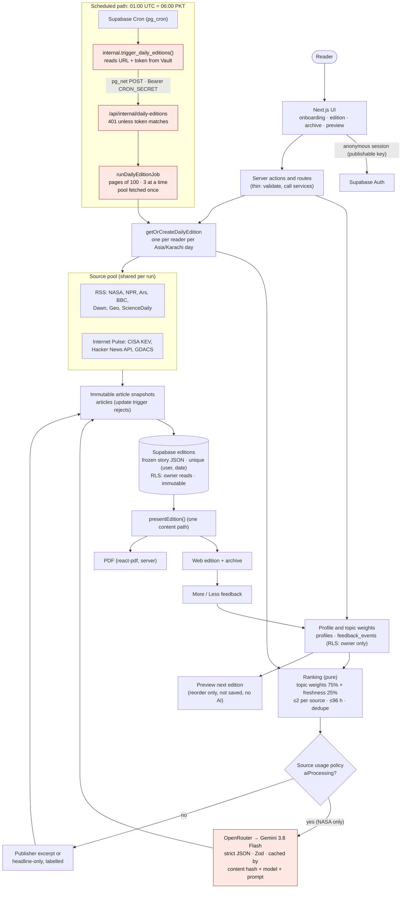

# Dayline architecture

One Next.js application on Vercel and one Supabase project. Pure domain logic lives in `src/domain`; external systems are reached only through adapters in `src/server`.

## Secrets (all server-only)

| Secret | Used by | Never |
|---|---|---|
| `SUPABASE_SECRET_KEY` | `getSupabaseAdmin()`: shared tables (articles, summaries), inserting a verified reader's edition, the daily job | in the browser; for reader reads |
| `SUPABASE_DB_URL` | `npm run db:migrate`, `npm run cron:setup` (local tooling only) | in the deployed app |
| `OPENROUTER_API_KEY` | `src/server/ai/openrouter-client.ts` | logged or returned |
| `CRON_SECRET` | daily endpoint (Vercel), Supabase Vault (`dayline_cron_secret`) | committed, logged or returned |

Public by design: `NEXT_PUBLIC_SUPABASE_URL` and `NEXT_PUBLIC_SUPABASE_PUBLISHABLE_KEY`, with data protected by RLS. Highlighted nodes in the diagram handle server-only secrets.

## Data model

| Table | Purpose | Protection |
|---|---|---|
| `profiles` | topics (1–3) and derived topic weights | RLS owner select/insert/update |
| `feedback_events` | one current More/Less per reader + edition + story; topics copied from the snapshot | RLS owner; inserts must reference the reader's own edition |
| `articles` | immutable article snapshots keyed by content hash | server-only; update trigger rejects |
| `article_summaries` | cached grounded summaries keyed by (hash, model, prompt version) | server-only; immutable |
| `editions` | one per reader per local date; frozen story JSON | RLS owner read; immutable; unique (user_id, local_date) |

## Request paths

- **Reader request:** reader's cookie session → `auth.getUser()` → RLS-scoped reads → generation (shared writes through the secret client) → re-read through the reader client.
- **Scheduled run:** Vault token → endpoint → job loads reader ids itself (never from the caller) → the same generation with a shared pool → counts-only response.
- **Failure isolation:** each source is fetched independently; an AI failure falls back to the excerpt; one reader's failure in the job doesn't stop the others.
